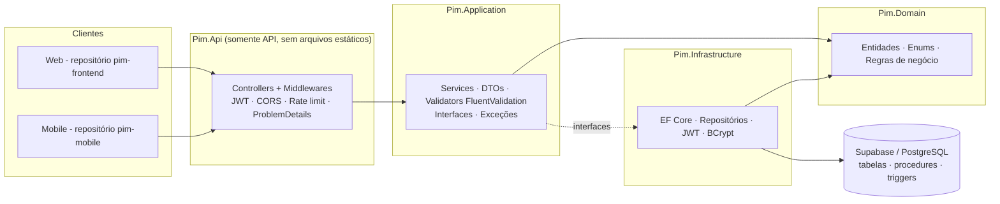

# Arquitetura

## Camadas (.NET 8)



Dependências: `Api → Application, Infrastructure`; `Infrastructure → Application → Domain`. O Domain não depende de nada.
Controllers só falam com services; services dependem de **interfaces** (repositórios, hasher, token, usuário atual) implementadas na Infrastructure/Api, o que permite testá-los com fakes.

## Fluxo de autenticação

```mermaid
sequenceDiagram
  participant C as Cliente (web/mobile)
  participant A as API
  participant B as Banco
  C->>A: POST /auth/login (email, senha)
  A->>B: busca usuário; BCrypt.Verify; controla tentativas/bloqueio
  A->>B: grava hash SHA-256 do refresh token
  A-->>C: accessToken (15 min) + refreshToken (7 dias)
  C->>A: requisições com Authorization: Bearer accessToken
  A-->>C: 401 (token expirado)
  C->>A: POST /auth/refresh (refreshToken)
  A->>B: revoga o token usado e emite novo par (rotação)
  A-->>C: novos tokens
  Note over A,B: Reuso de refresh já revogado ⇒ revoga todos os tokens do usuário
```

## Autorização
- Perfis: **Admin** (tudo), **Gestor** (colaboradores, equipes, tarefas, relatórios), **Colaborador** (vê/atualiza status/comenta apenas as próprias tarefas).
- `[Authorize(Roles=...)]` nos controllers **e** verificação de posse no `TarefaService` (`GarantirAcesso`), com filtro forçado por `ColaboradorId` nas listagens e no sync.

## Banco de dados
PostgreSQL (Supabase), schema `pim`. Regras que ficam no banco: histórico de status (trigger), `data_atualizacao` (triggers), inativação em vez de exclusão de colaborador com tarefas abertas (trigger), conclusão/reatribuição (procedures) e relatórios (funções). O `UnitOfWork` repassa o usuário ao banco com `set_config('app.usuario_id', …, true)` na transação do salvamento para a trigger de histórico registrar quem alterou. A API conecta diretamente (role `postgres`); RLS bloqueia o acesso pela Data API do Supabase.
