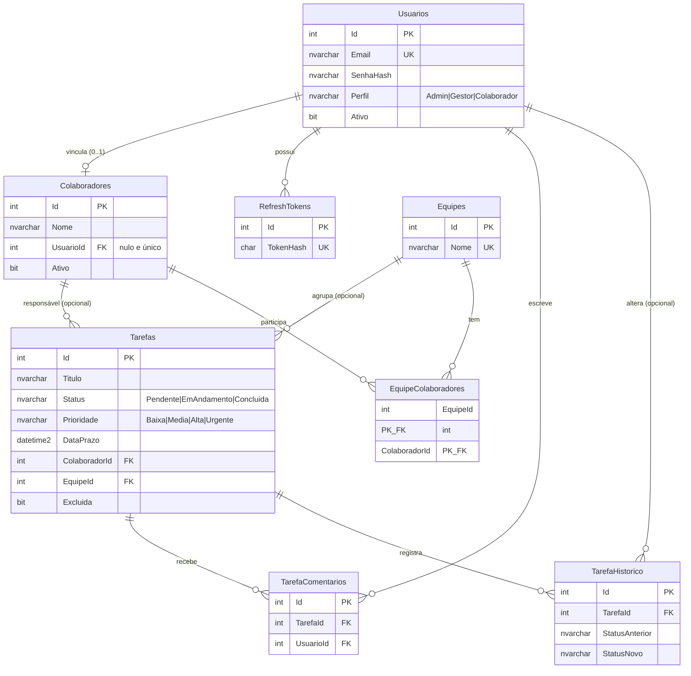

# MER e dicionário de dados

## Diagrama (modelo lógico)

## Dicionário resumido (modelo físico: ver `database/01_schema.sql`)

| Tabela | Colunas principais | Restrições / índices |
|---|---|---|
| Usuarios | Id, Nome, Email, SenhaHash, Perfil, Ativo, TentativasFalhas, BloqueadoAte, DataCriacao, DataAtualizacao | PK; UQ(Email); CK(Perfil) |
| RefreshTokens | Id, UsuarioId, TokenHash (SHA-256), DataExpiracao, DataRevogacao, SubstituidoPorHash | PK; UQ(TokenHash); FK Usuarios |
| Colaboradores | Id, Nome, Email, Cargo, Ativo, UsuarioId | PK; FK Usuarios; índice único filtrado em UsuarioId e Email (não nulos) |
| Equipes | Id, Nome, Descricao | PK; UQ(Nome) |
| EquipeColaboradores | EquipeId, ColaboradorId, DataEntrada | PK composta; FKs |
| Tarefas | Id, Titulo, Descricao, Status, Prioridade, DataPrazo, ColaboradorId, EquipeId, Excluida, DataCriacao, DataAtualizacao | PK; FKs; CK(Status), CK(Prioridade); IX Status, ColaboradorId, DataAtualizacao, EquipeId |
| TarefaComentarios | Id, TarefaId, UsuarioId, Texto, DataCriacao | PK; FKs; CK(Texto não vazio) |
| TarefaHistorico | Id, TarefaId, StatusAnterior, StatusNovo, UsuarioId, DataAlteracao | PK; FKs; alimentada por trigger |

Objetos: view `vw_TarefasDetalhadas`; procedures `sp_ConcluirTarefa`, `sp_ReatribuirTarefa`, `sp_ResumoTarefasPorColaborador`, `sp_TarefasAtrasadas`; triggers `trg_Tarefas_Historico`, `trg_Tarefas_DataAtualizacao`, `trg_Colaboradores_DataAtualizacao`, `trg_Usuarios_DataAtualizacao`, `trg_Colaboradores_BloqueiaExclusaoComTarefas`.
