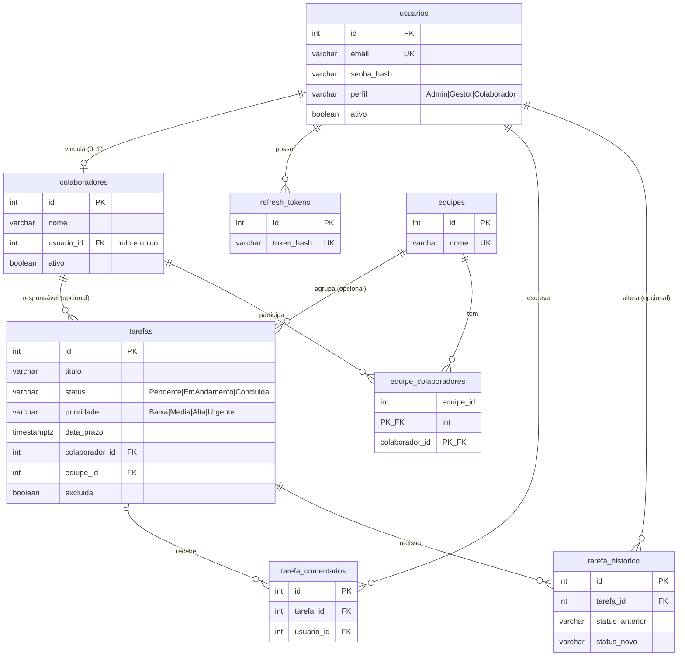

# MER e dicionário de dados (PostgreSQL / Supabase)

Schema `pim`; nomes em snake_case. Scripts em `database/` (fonte da verdade).

## Diagrama (modelo lógico)

## Dicionário resumido (modelo físico: `database/01_schema.sql`)

| Tabela | Colunas principais | Restrições / índices |
|---|---|---|
| usuarios | id, nome, email, senha_hash, perfil, ativo, tentativas_falhas, bloqueado_ate, data_criacao, data_atualizacao | PK; UQ(email); CK(perfil) |
| refresh_tokens | id, usuario_id, token_hash (SHA-256), data_expiracao, data_revogacao, substituido_por_hash | PK; UQ(token_hash); FK usuarios |
| colaboradores | id, nome, email, cargo, ativo, usuario_id | PK; FK usuarios; índices únicos parciais em usuario_id e email (não nulos) |
| equipes | id, nome, descricao | PK; UQ(nome) |
| equipe_colaboradores | equipe_id, colaborador_id, data_entrada | PK composta; FKs |
| tarefas | id, titulo, descricao, status, prioridade, data_prazo, colaborador_id, equipe_id, excluida, data_criacao, data_atualizacao | PK; FKs; CK(status), CK(prioridade); IX status, colaborador_id, data_atualizacao, equipe_id |
| tarefa_comentarios | id, tarefa_id, usuario_id, texto, data_criacao | PK; FKs; CK(texto não vazio) |
| tarefa_historico | id, tarefa_id, status_anterior, status_novo, usuario_id, data_alteracao | PK; FKs; alimentada por trigger |

Objetos:
- **View:** `vw_tarefas_detalhadas`.
- **Procedures** (`CALL`): `sp_concluir_tarefa`, `sp_reatribuir_tarefa`.
- **Funções de relatório** (`SELECT * FROM`): `sp_resumo_tarefas_por_colaborador`, `sp_tarefas_atrasadas`.
- **Triggers:** `trg_tarefas_historico`, `trg_tarefas_data_atualizacao`, `trg_colaboradores_data_atualizacao`, `trg_usuarios_data_atualizacao`, `trg_colaboradores_bloqueia_exclusao_com_tarefas`.
- **Segurança:** RLS ligado em todas as tabelas (sem policies) e permissões das roles `anon`/`authenticated` revogadas (`05_seguranca_supabase.sql`).
